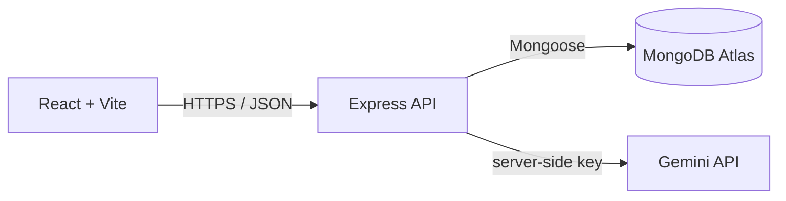

# EventFlow: Event Services and Booking Platform

An AI-assisted platform where customers browse event services, book them, and get a planning checklist and draft budget from an AI planner that only recommends services that exist in the catalog.

## Live links

| | URL |
|---|---|
| Frontend | https://eventflow-olive-gamma.vercel.app |
| Backend API | https://eventflow-api-yals.onrender.com |
| Health check | https://eventflow-api-yals.onrender.com/api/health |
| Repository | https://github.com/heyjustina/eventflow |

The backend runs on a free host that sleeps when idle. The first request can take 30 to 60 seconds to wake it up.

## Problem and users

Planning an event means finding venues, caterers, entertainers, and more across scattered sources, with no clear picture of cost. EventFlow gives one place to browse services, see affordability at a glance, get a plan, and book.

| User group | Examples |
|---|---|
| Personal | Birthdays, graduations, baby showers |
| Small business or organization | Galas, client appreciation, brunches, launches |
| Corporate | Conferences, festivals, trade shows |

## Features

- Register, log in, log out, and protected pages (JWT)
- Browse 16 fictional services across 9 categories, with search, category filter, and affordability labels ($, $$, $$$)
- Service detail pages
- Create, reschedule, and cancel bookings, with overlap protection
- "My Bookings" dashboard with upcoming count, active total, and cancelled count
- AI Event Service Planner (see below)
- Responsive layout

## AI feature: Event Service Planner

The customer enters event type, guest count, budget, and preferences. The backend:

1. Validates the input and limits its length.
2. Loads active services from MongoDB.
3. Sends only the needed service facts to Google Gemini, with the customer text treated as data, not instructions.
4. Requests structured JSON back.
5. Checks every recommended service ID against MongoDB and drops anything that doesn't exist.
6. Calculates the budget total itself from real prices.
7. Falls back to a rules-based planner if the AI is unavailable. The screen shows a badge for "AI-assisted" or "Rules-based".

The plan also lists "do it yourself" items and a general checklist. The AI never creates a booking. The customer must open a real service and confirm.

**Limitations:** the AI can choose a poor fit or phrase things imperfectly. It does not know availability. Recommendations are informational only.

**Responsible AI:** users are told not to enter personal details. The API key is only on the backend. Prompts and user text are not logged. The planner route is authenticated and rate limited.

## Architecture



| Tier | Technology | Responsibility |
|---|---|---|
| Presentation | React, Vite, React Router | Screens, forms, loading and error states |
| Application | Node, Express | Authentication, validation, business rules, AI orchestration |
| Data | MongoDB Atlas, Mongoose | Users, services, bookings |

React never talks to MongoDB or the AI provider directly, because the browser is public and secrets must stay on the server.

## Tech stack

React 19, Vite, React Router, Node.js, Express, MongoDB with Mongoose, bcryptjs, jsonwebtoken, helmet, express-rate-limit, Google Gemini API. Hosted on Vercel (frontend), Render (backend), and MongoDB Atlas (database).

## Project structure

```
eventflow/
├── client/            React app
│   └── src/
│       ├── api/           API helper (one place for fetch calls)
│       ├── components/    layout, ui, auth, services, tasks
│       ├── context/       AuthContext
│       ├── pages/         Home, Services, ServiceDetail, MyBookings, Planner, Login, Register
│       ├── styles/        CSS files
│       └── utils/         formatting, price tiers
├── server/            Express API
│   ├── scripts/           seed.js, testGemini.js
│   └── src/
│       ├── config/        database connection
│       ├── controllers/   request handlers
│       ├── middleware/    authentication
│       ├── models/        User, Service, Booking
│       ├── routes/        URL mapping
│       ├── services/      planner and Gemini services
│       ├── app.js
│       └── server.js
└── docs/screenshots/
```

## Run it locally

**Prerequisites:** Node.js 20 or newer, a free MongoDB Atlas cluster, and a Gemini API key from aistudio.google.com.

**1. Install**

```bash
cd server && npm install
cd ../client && npm install
```

**2. Environment variables**

Copy each `.env.example` file to `.env` and fill in your own values. Never commit `.env`.

`server/.env`

| Name | Purpose |
|---|---|
| `PORT` | Server port (5000) |
| `NODE_ENV` | `development` or `production` |
| `MONGODB_URI` | Atlas connection string |
| `JWT_SECRET` | Long random secret for signing tokens |
| `JWT_EXPIRES_IN` | Token lifetime, for example `1d` |
| `CLIENT_ORIGIN` | Allowed frontend origin(s), comma separated |
| `AI_API_KEY` | Gemini API key |
| `AI_MODEL` | One or more Gemini model names, comma separated |
| `ADMIN_EMAIL`, `ADMIN_PASSWORD` | Used only by the seed script to create an admin account |

`client/.env`

| Name | Purpose |
|---|---|
| `VITE_API_BASE_URL` | Public API address, for example `http://localhost:5000/api` |

**3. Seed the database** (this deletes all existing services and replaces them)

```bash
cd server
npm run seed
```

**4. Run**

```bash
# terminal 1
cd server && npm run dev

# terminal 2
cd client && npm run dev
```

Open http://localhost:5173.

## API summary

| Method | Path | Auth | Purpose |
|---|---|---|---|
| GET | `/api/health` | None | Server and database status |
| POST | `/api/auth/register` | None | Create a customer account |
| POST | `/api/auth/login` | None | Log in, returns a token |
| GET | `/api/auth/me` | Token | Current user |
| GET | `/api/services` | None | List active services (`category`, `q` filters) |
| GET | `/api/services/:id` | None | One service |
| POST | `/api/bookings` | Token | Create a booking |
| GET | `/api/bookings/mine` | Token | My bookings |
| GET | `/api/bookings/:id` | Owner or admin | One booking |
| PATCH | `/api/bookings/:id` | Owner or admin | Reschedule or edit notes |
| DELETE | `/api/bookings/:id` | Owner or admin | Cancel (status becomes `cancelled`) |
| POST | `/api/ai/recommend-service` | Token | AI-assisted service plan |

Errors use the shape `{ "error": "message", "details": [...] }`.

## Security notes

- Passwords are hashed with bcrypt and never returned.
- Login failures use one generic message.
- Public registration always creates a `customer`.
- Booking ownership is checked on the server, and the user ID comes from the verified token.
- Price and duration on a booking come from the database, not the request.
- Inputs are validated on the server. IDs are checked before database queries.
- Rate limits protect login, registration, and the AI planner.
- CORS allows only the configured frontend origin.
- Secrets live in environment variables and `.env` is git-ignored.

## Testing

Core workflows were tested manually in the browser, locally and on the deployed site: register, login, refresh, logout, browse and filter services, create a booking, reject an overlapping booking, reschedule, cancel, view another user's empty dashboard, and generate an AI plan, including the fallback path. See the SDLC document for the test table.

## Known limitations

- The authentication token is stored in `localStorage`, which is exposed if the site has a cross-site scripting flaw.
- The deployed database accepts connections from any address (`0.0.0.0/0`) because the free host has no fixed IP. It is still protected by credentials.
- Development and production share one Atlas database.
- Services, providers, and prices are fictional demo data.
- There is no availability calendar, payment, email, or provider account system.
- The earlier local planner pages (tasks, budget, run of show, print) still exist in the code but are not linked from the navigation, because they store data in the browser only.
- Admin service management through the interface is not built. Services are created by the seed script.

## Future improvements

Admin screens to add and edit services with image upload, real photos, saved AI plans, plan export to PDF and Excel, provider accounts and availability, payments, email confirmations, dark mode, and automated tests for booking rules.

## Screenshots

Add screenshots to `docs/screenshots/` and link them here:

| Screen | File |
|---|---|
| Home | `docs/screenshots/home.png` |
| Services | `docs/screenshots/services.png` |
| Service detail and booking form | `docs/screenshots/service-detail.png` |
| My Bookings | `docs/screenshots/my-bookings.png` |
| AI Planner | `docs/screenshots/planner.png` |
| Mobile | `docs/screenshots/mobile.png` |

## How AI was used during development

I used an AI assistant (Claude) as a mentor and code generator for planning, database design, code, debugging, and documentation. I ran and tested every step myself. The AI made mistakes, including a server startup crash, a deployment configuration error, a model that was unavailable, and an API key placed in an example file, and I diagnosed and fixed each one. The AI feature is built so the server validates every recommended service against MongoDB and calculates prices itself, so the model's output is never trusted blindly. The SDLC document has a table of specific examples.

## Credits

Illustrated banners are original SVG drawings made for this project. Service data is fictional.

## Author

Justina Williams. Built as a capstone project.